<p align="center">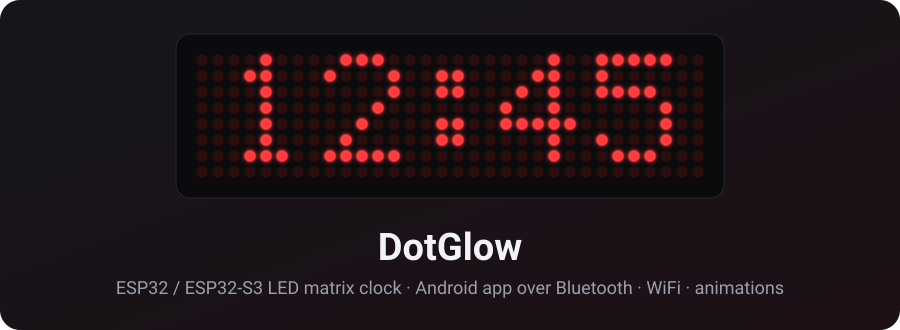</p>

<p align="center">
  <b>A WiFi + Bluetooth LED matrix clock for ESP32 and ESP32-S3, with its own Android app.</b><br>
  Set it up from your phone in two minutes: no computer, no app accounts, no cloud.
</p>

<p align="center">
  
  
  
  
  
</p>

---

## Get the app (closed testing)

The DotGlow Android app is in **closed testing on Google Play**. Anyone in the tester group gets it:

1. Join the Google Group **[devmeettesters@googlegroups.com](https://groups.google.com/g/devmeettesters)**
   with the Google account you use on Play.
2. Open **[play.google.com/apps/testing/com.electroiot.dotglow](https://play.google.com/apps/testing/com.electroiot.dotglow)**
   and tap **Become a tester**.
3. Install the app from Google Play and keep it installed for at least 14 days.

Details: [mtpcode.com/apps/dotglow.html](https://mtpcode.com/apps/dotglow.html) · feedback: admin@mtpcode.com

## Contents

[Features](#features) · [How it works](#how-it-works) · [Parts](#parts) · [Wiring](#wiring) ·
[Install the firmware](#install-the-firmware) · [First setup](#first-setup) · [Using the clock](#using-the-clock) ·
[Stopwatch](#stopwatch) · [Updates](#updates) · [Troubleshooting](#troubleshooting) · [For developers](#for-developers) ·
[Roadmap](#roadmap) · [Credits](#credits)

## Features

| | |
|---|---|
| 📱 **Android app over Bluetooth** | Every setting, WiFi setup, firmware updates, live previews ([DotGlow-Android](https://github.com/ElectroIoT/DotGlow-Android)) |
| 🔒 **Secure pairing** | 6-digit PIN shown on the LED display, encrypted Bluetooth (LE Secure Connections) |
| 🌐 **Web dashboard too** | Settings page on the clock's IP address, with a login |
| 🕒 **Internet time** | NTP with time zones and daylight saving, 12 / 24 hour, leading zero, blinking colon, seconds bar, date |
| ✨ **Animations** | 6 digit-change styles, 5 effects (hourly and at power-on), scrolling messages, special days (birthdays...) |
| 🌙 **Brightness** | Manual, night mode with its own brightness (or display off), optional light sensor (LDR) |
| ⏱️ **Stopwatch** | From the app or with an optional push button |
| 🔄 **Rotate 180°** | Mounted upside down? One tap in the app, or double-press BOOT |
| 🧱 **4 to 16 modules** | 8x32 up to 8x128, any module type (FC-16, generic, Parola, IC-Station), mirror / flip |
| ⬆️ **Updates** | From GitHub over WiFi, from the app over Bluetooth, or a new board straight from the phone over USB |
| 🛟 **Safe mode** | After repeated crashes it starts with only WiFi + updates, so a bad update can always be fixed |

### Digit-change styles

| Roll down | Roll up | Dissolve |
|:-:|:-:|:-:|
| 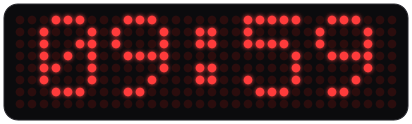 |  |  |
| **Slide** | **Flip** | **Drop & bounce** |
|  |  |  |

### Effects (every hour, at power-on, or on demand)

| Sparkle | Wipe | Rain |
|:-:|:-:|:-:|
| 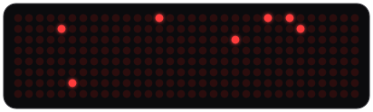 | 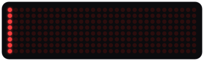 | 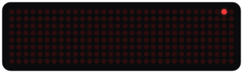 |
| **Boxes** | **Pac-Man** | **Stopwatch** |
| 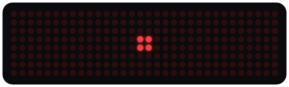 | 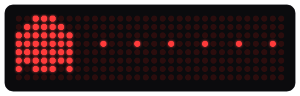 | 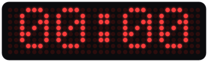 |

All pictures are generated from the firmware's own fonts and frame logic (`tools/make_images.py`), so they match the real display.

## How it works

<p align="center"></p>

- The **app** talks to the clock over **Bluetooth LE**: paired once with the PIN on the display, then encrypted.
- The **clock** gets the time over **WiFi** and checks for updates. It works on its own; the phone is only for setup and control.
- The same settings are on the clock's **web page** (any browser on the same WiFi).
- Protocol details: [docs/PROTOCOL.md](docs/PROTOCOL.md).

## Parts

| Part | Notes |
|---|---|
| ESP32-S3 DevKitC-1 **or** ESP32 DevKit (WROOM-32) | Any flash size from 4 MB. ESP32-S2 has no Bluetooth: not supported |
| MAX7219 4-in-1 LED matrix (8x32) | The common blue "FC-16" boards. Chain more for 8x64 ... 8x128 |
| 5 jumper wires | Female-female for most boards |
| **5 V / 1 A (or stronger) phone charger** + cable | **Required.** A computer USB port is too weak for the display, see [power](#power-read-this) |
| 470-1000 µF capacitor | Across VCC / GND at the display (+ leg to VCC). Strongly recommended |
| *Optional:* LDR + 10 kΩ resistor | Automatic brightness |
| *Optional:* push button | [Stopwatch](#stopwatch) without the phone |
| *Optional:* 3D-printed case | [hardware/enclosure](hardware/enclosure): leaning desk case, smoked acrylic front, DC jack; STLs for ESP32-S3, ESP32 DevKit, NodeMCU, D1 mini |

<p align="center"><a href="hardware/enclosure">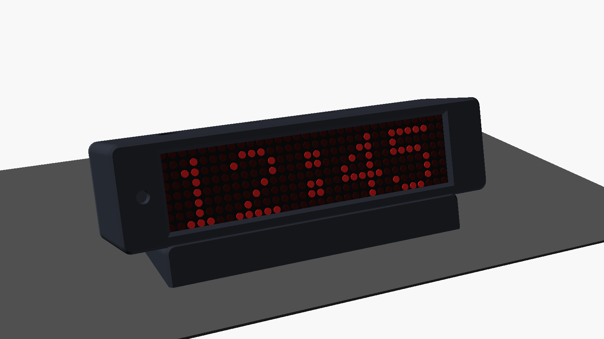</a></p>

Using an ESP8266 / NodeMCU instead? That is the [ESP8266 Matrix Clock](https://github.com/ElectroIoT/ESP8266-Matrix-Clock) (WiFi + web page, no Bluetooth). The DotGlow app can install it too.

## Wiring

| ESP32-S3 DevKitC-1 | ESP32 DevKit |
|:-:|:-:|
|  |  |

| MAX7219 | ESP32-S3 | ESP32 DevKit |
|---|---|---|
| VCC | 5V | VIN (5V) |
| GND | GND | GND |
| DIN | GPIO11 | GPIO23 |
| CS | GPIO10 | GPIO5 |
| CLK | GPIO12 | GPIO18 |
| *LDR (optional)* | GPIO1 | GPIO34 |
| *Stopwatch button (optional)* | GPIO4 | GPIO13 |

**Light sensor:** LDR from 3V3 to the LDR pin, 10 kΩ from that pin to GND, then turn on *Auto brightness*.

> ⚠️ **ESP32 DevKit:** never use the pins labelled **CLK, SD0, SD1, SD2, SD3, CMD**. They are the board's flash
> memory pins; a wire there stops the board from starting (`invalid header: 0xffffffff`). The display's CLK goes to
> **D18**, not to the pin called "CLK". Always wire the display's **IN** end (pins marked DIN), not DOUT.

### Power (read this)

<p align="center">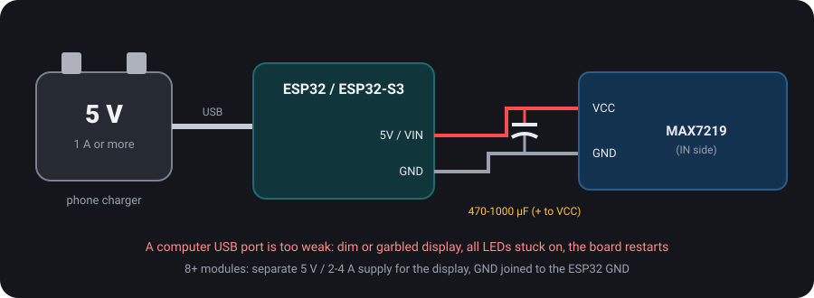</p>

Power the clock from a **5 V / 1 A (or stronger) phone charger**. A computer's USB port cannot drive the display:
the LEDs stay dim, all LEDs stay on or show garbage, the board keeps restarting and drops off USB.
That was the cause of every "display does not work" case during testing; a 1 A charger fixed all of them.
Flashing from a computer is fine; test the display on the charger.

### More modules and power

<p align="center">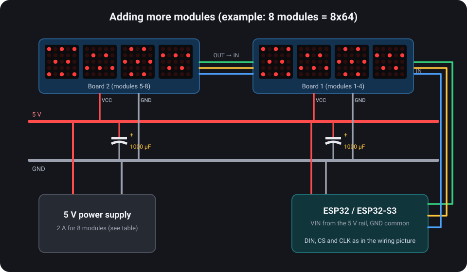</p>

Connect **OUT** of one board to **IN** of the next, then set the module count in the app (*Display*).

| Modules | Display | Supply |
|---|---|---|
| 4 | 8x32 | 5 V / 1 A (USB is fine) |
| 8 | 8x64 | 5 V / 2 A, separate supply |
| 12 | 8x96 | 5 V / 3 A |
| 16 | 8x128 | 5 V / 4 A |

Above 4 modules feed 5 V to the boards directly (not through the ESP32), with a 470-1000 µF capacitor at each board.

## Install the firmware

### A. From your phone (easiest)

1. Install the **DotGlow** app (closed testing: see [Get the app](#get-the-app-closed-testing)).
2. Plug the board into the phone with a USB-OTG adapter (or a USB-C data cable).
3. In the app: **Install firmware → Find my board → Install**. The app detects ESP32 / ESP32-S3 and writes the right image (about 20-60 s).

### A1. From your browser (nothing to install)

Open **[mtpcode.com/flash](https://mtpcode.com/flash/)** in Chrome or Edge on a computer, plug the board in, press
**Install**. ESP32, ESP32-S3 and ESP8266 (NodeMCU / D1 mini).

### A2. From a PC (no phone, no PlatformIO)

[desktop-flasher](desktop-flasher): a small program that finds the board, downloads the latest firmware and installs it
(window or command line, Windows / Linux / macOS). `python desktop-flasher/dotglow_flasher.py` or the `.exe`.

### B. PlatformIO

```bash
pio run -e esp32s3 -t upload --upload-port COM5     # ESP32-S3 (the "USB" port)
pio run -e esp32dev -t upload                        # classic ESP32
```

### C. esptool, with a release image

```bash
esptool.py write_flash 0x0 dotglow-esp32s3-full.bin
```

Full images (bootloader + partitions + app) are made by `python tools/release.py`.

## First setup

<p align="center">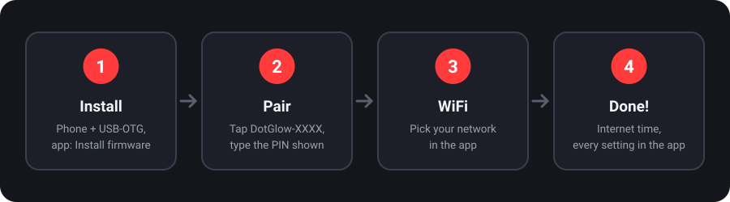</p>

1. **Power on.** The clock plays its welcome animation and shows *manoranjan.dev*.
2. **Pair.** In the app tap **DotGlow-XXXX**. The clock shows a 6-digit PIN; type it in Android's pairing request.
3. **WiFi.** Tap **Set up**, pick your network, type the password. The clock restarts and fetches the time.
4. **Done.** Change anything from the app. The clock scrolls its IP address for the web page.

No app? The clock opens a WiFi hotspot **DotGlow-XXXX**; join it and the setup page opens (or http://192.168.4.1).

## Using the clock

- **App:** brightness, night mode, time format and zone, digit style, effects, messages, special days, display layout, updates, security.
- **Web page:** `http://<clock IP>` or `http://dotglow.local`, with an optional login password.
- **BOOT button:** short press = scroll the IP · **double press = rotate the display 180°** · hold 5 s = WiFi setup ·
  hold 10 s = remove the web password.

## Stopwatch

**On the display**

| Running | Paused (blinks) | After an hour |
|:-:|:-:|:-:|
|  | 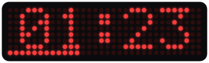 | 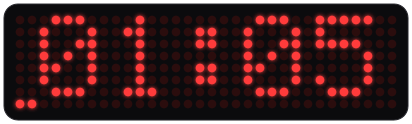 |
| `MM:SS`, tenths fill the bottom row | Digits blink, time kept | `HH:MM`, the bottom row fills once a minute |

**Button wiring (optional)**

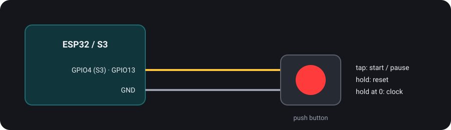

- **In the app:** *Stopwatch* → Start / Pause / Reset / Back to the clock. The app shows a live copy of the display.
- **With a button** (optional, from GPIO4 on the S3 / GPIO13 on the ESP32 to GND, no resistor needed):
  tap = start / pause (from the clock: open the stopwatch), hold = reset, hold at 0 = back to the clock.
- With 6 or more modules it shows `HH:MM:SS` all the time.

## Updates

| How | When to use |
|---|---|
| **GitHub over WiFi** | Automatic at night (if enabled) or *Updates → Check now* |
| **App over Bluetooth** | *Updates → Update over Bluetooth*: no WiFi needed, about 30 s |
| **USB from the phone** | New or broken boards: *Install firmware* |
| **Web upload** | *Upload firmware.bin* on the web page (password protected) |

## Troubleshooting

| Problem | Fix |
|---|---|
| Board light is on but the app doesn't see the clock | **Join the grounds:** display GND, board GND and the power supply GND must be connected together. Use a stable 5 V supply: a weak one restarts the board when Bluetooth starts |
| Dim, all LEDs stuck on, or garbage | **Power:** use a 5 V / 1 A charger, not a computer USB port; add the capacitor |
| Only the first module works | A broken link between modules (re-solder the joints between module 1 and 2) |
| ESP32 doesn't start after wiring | A wire is on CMD / SD0-SD3 / CLK (flash pins): move it |
| Text scrambled / mirrored | App → Display → module type / mirror / flip |
| Upside down | App → Display → **Rotate 180°**, the rotate button on the dashboard, or **double-press BOOT** |
| Keeps restarting | Better 5 V supply, add the capacitor; after 3 crashes it starts in safe mode |
| Can't pair | Use the PIN on the display (not 0000 / 1234). After a factory reset the app re-pairs by itself |
| "Getting time..." forever | WiFi has no internet, or the time zone is wrong (App → Clock & time) |
| Board drops off USB / flash stops half way | Take the display's 5 V wire off the board while flashing (the display draws more than USB gives); short thick data cable, another port |
| USB install fails | Use a data cable; hold BOOT, tap RESET, release BOOT, try again |

## For developers

| Doc | What's in it |
|---|---|
| [docs/ARCHITECTURE.md](docs/ARCHITECTURE.md) | Modules, main loop, settings storage, safe mode, OTA |
| [docs/PROTOCOL.md](docs/PROTOCOL.md) | Bluetooth GATT service, request / response format, every operation |
| [docs/DEVELOPMENT.md](docs/DEVELOPMENT.md) | Build envs, test build, serial gotchas, testing with the app |
| [docs/RELEASE.md](docs/RELEASE.md) | Version bump, release images, publishing the firmware catalog |
| [CHANGELOG.md](CHANGELOG.md) | What changed in each version |
| [CLAUDE.md](CLAUDE.md) | Quick brief for AI coding assistants |

## Roadmap

| Phase | What | Status |
|---|---|---|
| 1 | ESP32 / ESP32-S3 port of the ESP8266 Matrix Clock | 🟡 runs on an ESP32-S3; test with a real display pending |
| 2 | Bluetooth service + protocol | ✅ tested on a Motorola Edge 40 Neo (Android 15) |
| 3 | Android app: pairing, dashboard | ✅ |
| 4 | Android app: all settings, WiFi setup, app PIN lock, setup guide | ✅ |
| 5 | Firmware updates over Bluetooth | ✅ 1.2 MB in 26 s |
| 6 | Flash a new board from the phone over USB-OTG (ESP32, ESP32-S3, ESP8266) | ✅ tested on an ESP32-S3 |
| 6b | Stopwatch with an optional button | ✅ |
| 6c | 3D-printed case (OpenSCAD, parametric) | 🟡 designed, test print pending |
| 6d | Temperature + humidity from a DHT22 (shown on the display and in the app); the case has a pocket for it | ⬜ planned |
| 7 | Public release | ⬜ |

## Credits

- Based on the author's own [ESP8266 Matrix Clock](https://github.com/ElectroIoT/ESP8266-Matrix-Clock) (MIT).
- [MD_MAX72XX](https://github.com/MajicDesigns/MD_MAX72XX) by Marco Colli (LGPL-2.1) for the display driver.
- [NimBLE-Arduino](https://github.com/h2zero/NimBLE-Arduino) (Apache-2.0) for Bluetooth.
- [ArduinoJson](https://arduinojson.org) by Benoît Blanchon (MIT).
- [Arduino-ESP32 core](https://github.com/espressif/arduino-esp32) (LGPL-2.1).

## License

MIT, see [LICENSE](LICENSE). Made with care in India by [Manoranjan](https://manoranjan.dev) · [ElectroIoT](https://electroiot.in).

### Name and logo

The code is MIT licensed, but the **DotGlow** name, logo and app icon are not covered by the licence.
Forks and rebuilt apps are welcome; please publish them under your own name, icon and package
(not `com.electroiot.dotglow`), so users can tell them apart from the official app.
