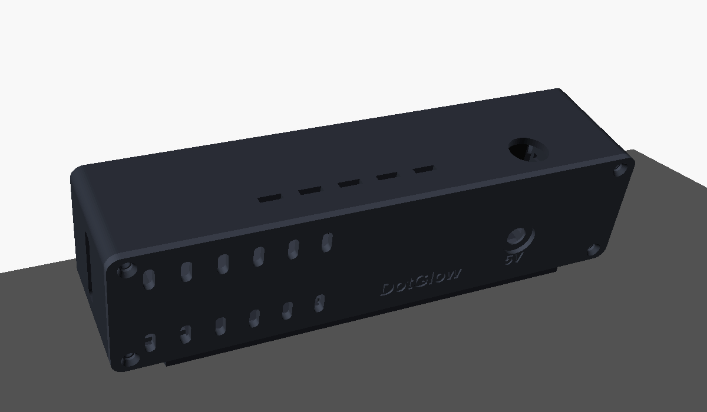
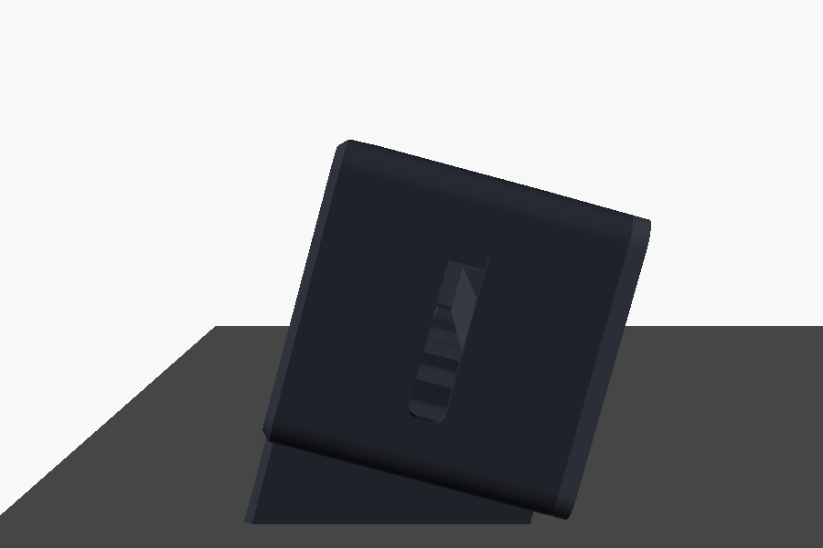
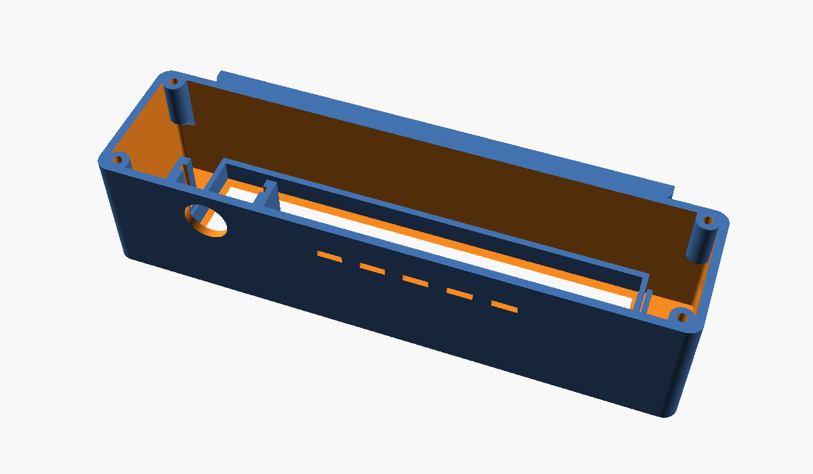
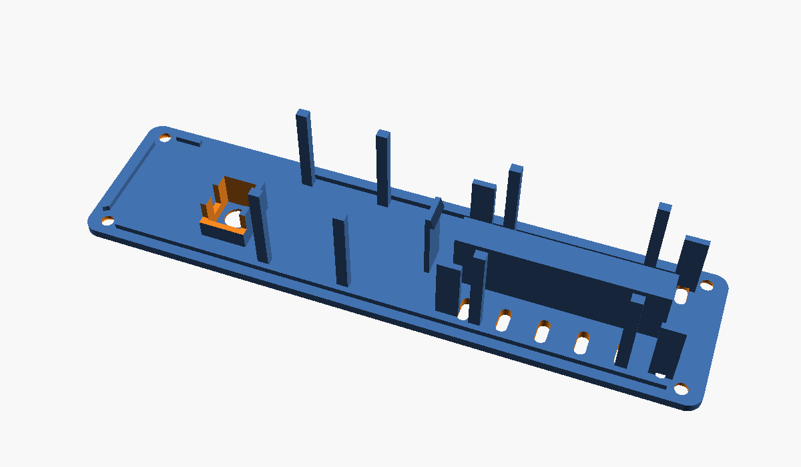
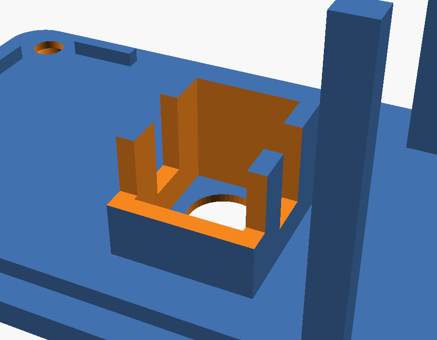
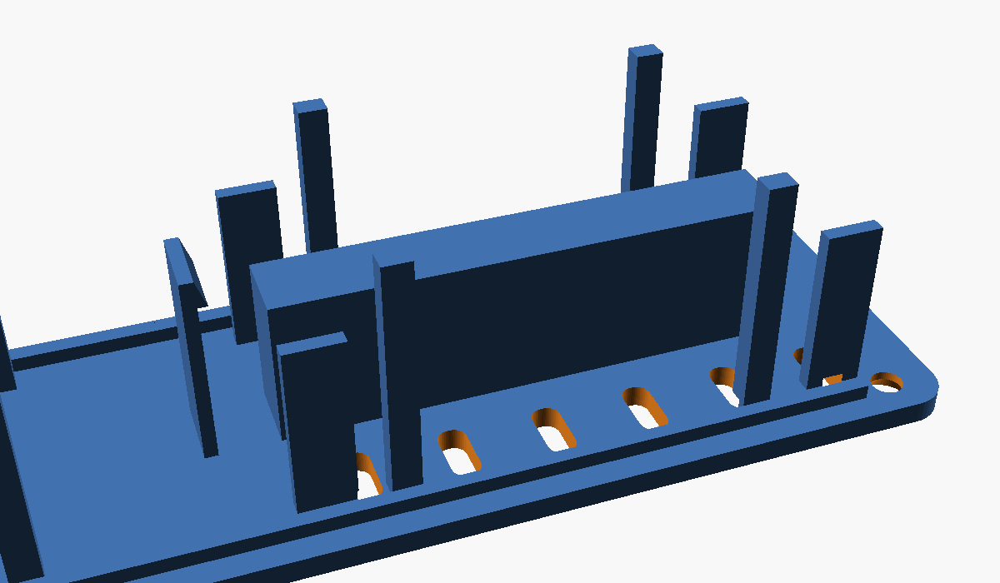

# DotGlow case "Lean" (3D print)

<p align="center"></p>

A desk case for an **ESP32-S3 DevKitC-1** and a **MAX7219 4-in-1 (8x32)** display:

- **Leaning face** (15° by default) so you read it straight from a desk or a shelf. Any angle: `lean = 30` makes the
  pedestal taller by itself.
- **Smoked acrylic** front: unlit LEDs disappear, lit digits glow.
- **Floating pedestal**: narrower than the case, so the clock looks like it hovers.
- **Open back** with a **removable back plate**, closed with **4 screws** or **push-fit snaps**.
- **DC jack** in the back plate (PCB jack like DC-005, or a threaded panel jack).
- Optional **USB-C slot** for the ESP32 (flashing / USB power), **push button** on top (12x12 switch with its round
  cap, or a panel button), **light sensor** hole.

Fully parametric OpenSCAD: [dotglow_case.scad](dotglow_case.scad).

| | |
|---|---|
| Case | **165 x 41 x 42 mm** + pedestal (15 mm at 15°) |
| Front window | **132 x 36 x 2 mm** smoked (grey / bronze) or red-tinted acrylic |
| Print | PLA or PETG, 0.2 mm, 3 walls, 15-20 % infill, **no supports** |
| Bed | 220 x 220 mm or bigger |

<p align="center">
  
  
</p>

## Files

| File | Print | How |
|---|---|---|
| [stl/dotglow-testfit.stl](stl/dotglow-testfit.stl) | 1 (optional, ~15 min) | front face down. Check that the acrylic and the display drop in |
| [stl/dotglow-shell.stl](stl/dotglow-shell.stl) | 1 | **front face down** (smooth front from the bed). The pedestal prints at an angle, no supports |
| [stl/dotglow-back.stl](stl/dotglow-back.stl) | 1 | outside face down (posts up) |

Variants in [stl/variants/](stl/variants): snap-fit shell + back (`*-snap.stl`, no screws), back for a threaded panel
jack (`dotglow-back-panel-jack.stl`), back with only a tape ridge for the ESP32 (`dotglow-back-tape.stl`),
30° shell (`dotglow-shell-lean30.stl`).

<p align="center">
  
  
</p>

## Options (top of `dotglow_case.scad`)

| Option | Values | Default |
|---|---|---|
| `lean` | angle of the face, degrees | `15` |
| `back_fix` | `"screw"` (4 x M3) / `"snap"` (push-fit, finger notch at the bottom) | `"screw"` |
| `dc_jack` | `"pcb"` (DC-005, glued into a cradle, wires soldered) / `"panel"` (8 mm threaded jack + nut) / `"none"` | `"pcb"` |
| `board_mount` | `"cradle"` (guides + snap hook) / `"tape"` (ridge + foam tape only) | `"cradle"` |
| `usb_c` | `true` / `false`: slot for the ESP32's USB-C ports in the right side | `true` |
| `button` | `"tactile12"` (12x12 switch + round cap on a small perfboard) / `"panel"` (7 mm) / `"none"` | `"tactile12"` |
| `ldr` | `true` / `false`: 5 mm light sensor hole, front left | `true` |
| `acr_t` | acrylic thickness; `0` = no acrylic, print a 0.6 mm front skin in white / natural filament | `2.0` |

**Measure your parts first** (clone boards differ): `disp_w`, `disp_h`, `matrix_h` (LED front to PCB front),
`board_l`, `board_w`, `dupont` (16 with Dupont plugs, about 8 if you solder wires), `dc_body` + `dc_axis` (your jack),
`tact_stack` (perfboard top to the top of the switch cap).

Render after a change (OpenSCAD 2021+, free):

```bash
openscad -o stl/dotglow-shell.stl -D 'part="shell"' dotglow_case.scad
openscad -o stl/dotglow-back.stl  -D 'part="back"'  dotglow_case.scad
openscad -o stl/dotglow-shell.stl -D 'part="shell"' -D 'lean=30' -D 'back_fix="snap"' dotglow_case.scad   # example
```

## Parts

| Part | Notes |
|---|---|
| Smoked acrylic 132 x 36 x 2 mm | Sign shop / laser service. Or clear acrylic + window tint film |
| DC jack 5.5 x 2.1 mm | PCB type (DC-005) or threaded panel type (8 mm hole) |
| **5 V / 2 A** adapter with a 5.5 x 2.1 mm plug | **5 V only.** 9 V / 12 V will destroy the display and the board |
| 12x12 mm tactile switch + round cap, 24 x 20 mm perfboard | Stopwatch button (optional) |
| 4 x M3 x 8 mm countersunk thread-forming screws | Only for `back_fix = "screw"` (or M3 heat-set inserts with `screw_d = 4.0`) |
| Super glue (CA) | DC-005 jack into its cradle |
| Double-sided foam tape (optional) | Under the ESP32 on the ridge |
| 5 mm LDR + 10 kΩ (optional) | Auto brightness |
| 470-1000 µF capacitor | Across the display VCC / GND |

## Mounting the DC jack and the ESP32

<p align="center">
  
  
</p>

**DC-005 jack (glue + solder).** On the inside of the back plate there is a cradle the exact size of the DC-005
(9.0 x 11.0 x 14.2 mm, 0.2 mm glue gap):

1. Push the jack in, **barrel opening first**, pins pointing **down** (towards the "5V" label). The front face sits
   on the plate and the barrel lines up with the hole. Check with the plug from outside before gluing.
2. Put **2-3 drops of super glue** (CA) through the **glue windows** in the two side walls. Let it set 5 minutes.
   Don't let glue run into the barrel opening.
3. The back 4 mm of the jack and all pins stay outside the cradle: solder the wires (centre pin = **+5 V**,
   sleeve / bottom pin next to it = **GND**; check with a multimeter, clones differ). Heat-shrink the joints.

If your jack is a different size, measure it and set `dc_body = [width, height, length]` and `dc_axis` (plug axis
height above the pin side).

**ESP32-S3 board.** It sits on the **ridge** on the inside of the back plate, **parts side up** (towards the display),
the header pins and Dupont plugs hang down on both sides of the ridge:

- `board_mount = "cradle"` (default): four **side guides** keep it from sliding, the **USB-C end** goes against the
  right side (ports in line with the side slot), and the other end **snaps under the hook**: press the board down
  until it clicks. To take it out, push the hook back with a fingernail. A strip of foam tape on the ridge is optional
  (stops rattling).
- `board_mount = "tape"`: only the ridge and an end stop; fix the board with double-sided foam tape or a few dots of
  hot glue on the ridge.

The board travels with the back plate, so leave the wires to the display about 10 cm long; then you can open the back
and lay the plate next to the case without unplugging anything.

## Assembly

1. **Flash and test on the bench first** (app → *Install firmware*), powered from the 5 V adapter or a phone charger.
2. Shell front face down: drop in the **acrylic**, then the **display** with the LEDs first. The display's
   **DIN (IN) end goes to the right** (seen from the front), the side with the USB-C slot.
3. **DC jack**: glue it into its cradle and solder the two wires (see above).
4. **Wiring** (power from the jack feeds both, the ESP32 through its 5V pin):

   | From | To |
   |---|---|
   | DC jack +5 V | display VCC **and** ESP32 **5V** |
   | DC jack GND | display GND **and** ESP32 **GND** |
   | display DIN / CS / CLK | GPIO11 / GPIO10 / GPIO12 |
   | button (tactile12 / panel) | GPIO4 and GND |
   | LDR | 3V3 → LDR → GPIO1, 10 kΩ from GPIO1 to GND |

   Add the capacitor at the display's VCC / GND. Don't plug USB and the DC adapter in at the same time for long
   (both feed 5V); for flashing over USB, unplug the adapter.
5. **Button**: solder the 12x12 switch in the middle of the perfboard, press its round cap on, slide the perfboard
   into the two rails under the top (from the open back) until the cap comes out of the hole.
6. **ESP32**: press it into the cradle on the back plate until the hook clicks (see above).
7. Close the back: the posts press the display against the acrylic. Screws, or push until the snaps click
   (open again with a fingernail in the notch at the bottom).

## Tips

- **Black, dark grey or matte gold PLA** look best behind smoked acrylic; print the shell in one colour and the back
  plate in another for a two-tone look.
- Upside down after assembly? App → **Display → Rotate 180°**.
- The pedestal is solid: 20 % infill makes the clock heavy enough not to tip when you press the button.
- `part="assembly"` in OpenSCAD (F5) shows the whole clock on a desk.
