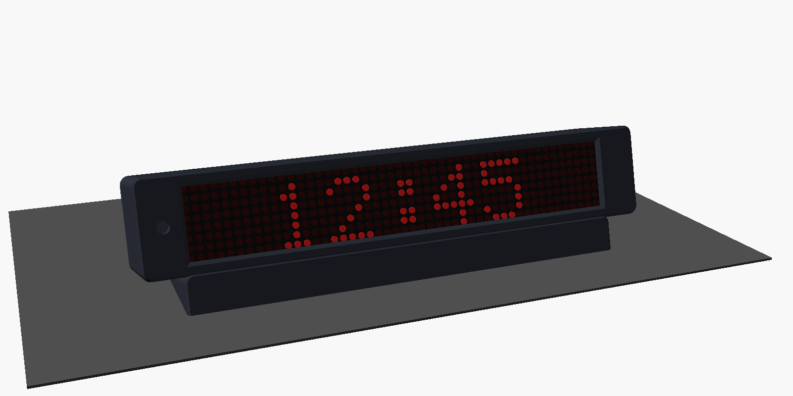
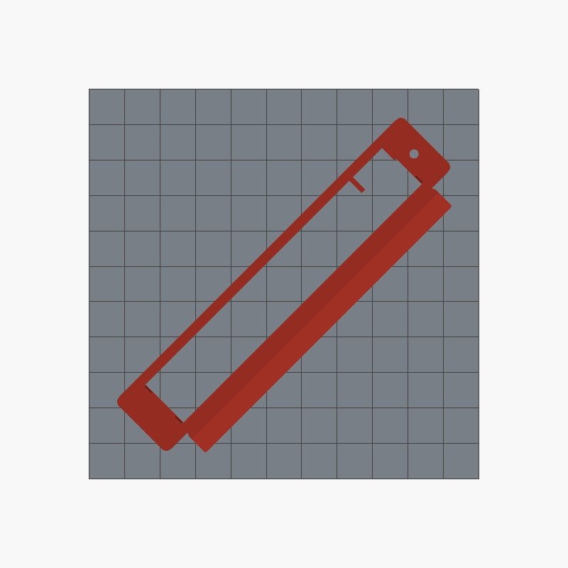
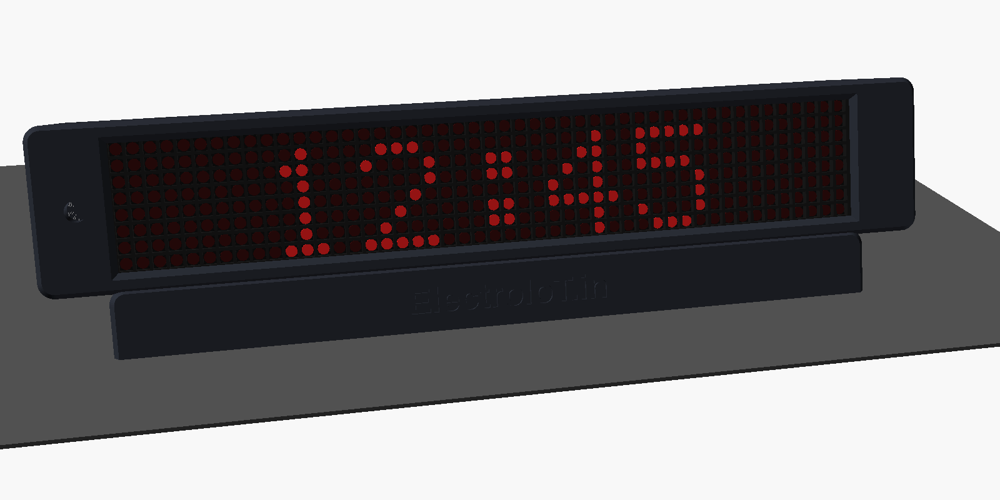
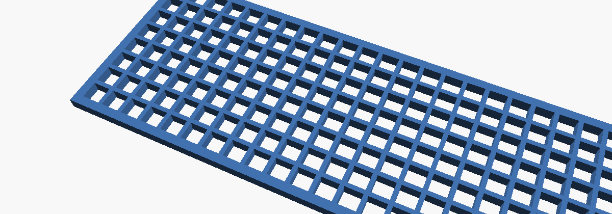
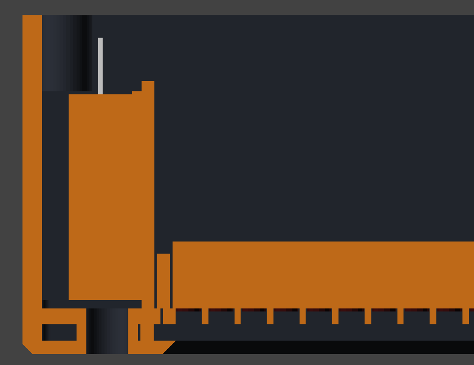

# DotGlow case "Lean" (3D print)

<p align="center"></p>

A desk case for a **MAX7219 4-in-1 (8x32)** display and **your choice of board**: ESP32-S3, ESP32 DevKit (30 or 38
pins / ESP32-S), ESP8266 NodeMCU (v2 or v3) or Wemos D1 mini. Ready-made STLs for every board, with or without the
stopwatch button, screwed or snap-fit back.

- **Leaning face** (15° by default) so you read it straight from a desk or a shelf. Any angle: `lean = 30` makes the
  pedestal taller by itself.
- **Smoked acrylic** front: unlit LEDs disappear, lit digits glow.
- **Floating pedestal**: narrower than the case, so the clock looks like it hovers.
- **Open back** with a **removable back plate**, closed with **4 screws** or **push-fit snaps**.
- **DC jack** in the back plate (PCB jack like DC-005, or a threaded panel jack).
- **USB slot** on the right side in line with the board's USB port (USB-C or micro-USB), **push button** on top
  (12x12 switch with its round cap), **light sensor** hole.

Fully parametric OpenSCAD: [dotglow_case.scad](dotglow_case.scad).

| | |
|---|---|
| Case | **165 x 41 x 42 mm** + pedestal (15 mm at 15°) |
| Front window | **132 x 36 x 2 mm** smoked (grey / bronze) or red-tinted acrylic |
| Print | PLA or PETG, 0.2 mm, 3 walls, 15-20 % infill, **no supports** |
| Bed | 220 x 220 mm or bigger |

<p align="center">
  
  
</p>

## Pick your board

| Your board | Firmware | Folder |
|---|---|---|
| ESP32-S3 DevKitC-1 (N8R2 / N16R8, two USB-C) | DotGlow (app + Bluetooth) | [stl/esp32-s3](stl/esp32-s3) |
| ESP32 DevKit V1, 30 pins (DOIT, micro-USB) | DotGlow (app + Bluetooth) | [stl/esp32-devkit-30pin](stl/esp32-devkit-30pin) |
| ESP32 DevKitC / "ESP32-S", 38 pins | DotGlow (app + Bluetooth) | [stl/esp32-devkit-38pin](stl/esp32-devkit-38pin) |
| ESP8266 NodeMCU v2 (Amica, CP2102, narrow) | [ESP8266 Matrix Clock](https://github.com/ElectroIoT/ESP8266-Matrix-Clock) (WiFi + web page) | [stl/esp8266-nodemcu-v2](stl/esp8266-nodemcu-v2) |
| ESP8266 NodeMCU v3 (LoLin, CH340, wide) | ESP8266 Matrix Clock | [stl/esp8266-nodemcu-v3](stl/esp8266-nodemcu-v3) |
| ESP8266 Wemos / LOLIN D1 mini | ESP8266 Matrix Clock | [stl/esp8266-d1-mini](stl/esp8266-d1-mini) |

Not sure which NodeMCU you have? Measure the width: about **26 mm = v2**, about **31 mm = v3**.
The DotGlow app installs the right firmware for every one of them (*Install firmware*).

Each folder has six files. **Print one shell + the matching back:**

| You want | Shell | Back |
|---|---|---|
| Stopwatch button, screws | `shell-button.stl` | `back.stl` |
| No button, screws | `shell-no-button.stl` | `back.stl` |
| Stopwatch button, snap-fit (no screws) | `shell-snap-button.stl` | `back-snap.stl` |
| No button, snap-fit | `shell-snap-no-button.stl` | `back-snap.stl` |

Snap shells only fit snap backs, and screw shells only fit screw backs.

## 6 modules (8x48, wider clock)

<p align="center">
  
  
</p>

For a 4-in-1 board plus two single modules (or any 6-module chain). The case is **229 mm** wide, too long to lie
straight on a 220 mm bed. Laid **diagonally** it needs only **189 x 189 mm**, so it prints on every
220 x 220 (Ender 3, Neptune, A1, K1, ...) and bigger printer. The files in
[stl/6-modules](stl/6-modules) are **already turned 45°**: load and print, don't rotate them back.
Same folders and file names as above, plus `dotglow-testfit.stl`. Acrylic: **196 x 36 x 2 mm**.
In the app: **Display → Modules = 6**; with 6 modules you can also turn on **Show seconds**.

8 modules (8x64, 293 mm) does not fit a 220 bed even diagonally: it needs a 300 mm bed, or ask for a split
version (printed in two halves).

## 6 modules "plus": light shield + name plate + DHT22 pocket

<p align="center"></p>

Same 6-module case with three extras switched on. The normal 6-module files stay as they are; this is a second set in
[stl/6-modules-plus](stl/6-modules-plus) (same board folders, same file names, pre-rotated 45° for a 220 mm bed).

**1. Light shield** (`dotglow-light-shield.stl`, print 1): a loose 2 mm grid between the acrylic and the LEDs, one
3.2 mm square cell per LED. Every dot becomes a sharp square and the light of one LED can't glow into the next.

<p align="center"></p>

- Print it **flat, in black** (matte black PLA or PETG; white or grey leaks light). 0.2 mm layers, **2 walls, 0 %
  infill, top / bottom layers 0**: the grid walls are 0.8 mm, exactly two perimeters. 30-40 mm/s. It is 194 x 36 mm,
  so it fits a 220 bed without turning.
- Assembly: acrylic first, then the grid (it drops into a seat in the shell, either side up), then the display, which
  clicks in behind the hooks and presses the grid against the acrylic. The case is 2 mm deeper (44 mm).
- With the shield on, the front window is a little bigger so the outer LEDs aren't covered.

**2. Name plate** "ElectroIoT.in": engraved 0.8 mm into the front of the base. Reads left to right from the front.
For a two-colour look print `dotglow-nameplate-inlay.stl` (the letters, 0.6 mm thick) in another colour and glue it into
the engraving with a drop of super glue. Another text? Set `plate_text = "Your name"` in `dotglow_case.scad`
(`plate_size` = letter height) and render the shell again.

<p align="center"></p>

**3. DHT22 pocket** (temperature + humidity sensor, AM2302): at the left end of the case, walled off from the warm
display and ESP32 by a partition, because a DHT22 inside the main box would read 3-5 °C too warm. The sensor stands
between two small walls, its grid face towards the end wall, which has vent slots (and two more slots in the top).
Wires leave through the gap behind the partition.

<p align="center"></p>

- Sensor: **DHT22 / AM2302, 15.1 x 25.2 x 7.7 mm**. The **3-pin module** version (pull-up resistor on the board) is
  easiest: **+ → 3V3**, **− → GND**, **OUT → a free GPIO** (suggested: ESP32-S3 **GPIO5**, ESP32 **GPIO27**,
  ESP8266 **D2**). Push it in with the grid facing the vented end wall, a drop of hot glue on the back.
- **The firmware cannot read it yet.** The pocket and the wiring are ready; showing temperature / humidity on the display
  and in the app is a planned firmware feature (see the roadmap). Until then the sensor just sits there.
- The LDR leads run along the top or bottom edge of the pocket to the gap behind the partition, like the sensor wires.

Not needed? Use the normal [6-modules](stl/6-modules) files.

Also: [stl/dotglow-testfit.stl](stl/dotglow-testfit.stl) (15 min, same for every board: checks the acrylic and the
display fit) and [stl/extras](stl/extras) (ESP32-S3: 30° lean shell, back for a threaded panel DC jack, back with a
plain tape ridge).

| Part | Orientation on the bed |
|---|---|
| shell | **front face down** (smooth front from the bed); the pedestal prints at an angle, no supports |
| back | outside face down (posts up) |

<p align="center">
  
  
</p>

## Options (top of `dotglow_case.scad`)

| Option | Values | Default |
|---|---|---|
| `lean` | angle of the face, degrees | `15` |
| `back_fix` | `"screw"` (4 x M3) / `"snap"` (push-fit, finger notch at the bottom) | `"screw"` |
| `dc_jack` | `"pcb"` (DC-005, glued into a cradle, wires soldered) / `"panel"` (8 mm threaded jack + nut) / `"none"` | `"pcb"` |
| `board_mount` | `"cradle"` (guides + snap hook) / `"tape"` (ridge + foam tape only) | `"cradle"` |
| `board` | `"esp32s3"`, `"esp32_30pin"`, `"esp32_38pin"`, `"nodemcu_v2"`, `"nodemcu_v3"`, `"d1_mini"` | `"esp32s3"` |
| `usb_slot` | `true` / `false`: slot for the board's USB port in the right side | `true` |
| `button` | `"tactile12"` (12x12 switch + round cap on a small perfboard) / `"panel"` (7 mm) / `"none"` | `"tactile12"` |
| `ldr` | `true` / `false`: 5 mm light sensor hole, front left | `true` |
| `shield` | `true` / `false`: seat for the light shield (print `part="shield"`) | `false` |
| `nameplate`, `plate_text` | `true` / `false`: text engraved in the base (and the text, `plate_size` = height) | `false`, `"ElectroIoT.in"` |
| `dht22` | `true` / `false`: DHT22 pocket at the left end | `false` |
| `acr_t` | acrylic thickness; `0` = no acrylic, print a 0.6 mm front skin in white / natural filament | `2.0` |

**Measure your parts first** (clone boards differ): `disp_w`, `disp_h`, `matrix_h` (LED front to PCB front),
the board preset in `boards = [...]` (length, width, USB slot), `dupont` (16 with Dupont plugs, about 8 if you solder wires), `dc_body` + `dc_axis` (your jack),
`tact_stack` (perfboard top to the top of the switch cap).

Render after a change (OpenSCAD 2021+, free), or run `./tools_export.sh` (4 modules), `./tools_export.sh 6` or
`./tools_export.sh 6 plus` to rebuild every STL:

```bash
openscad -o shell.stl -D 'part="shell"' -D 'board="d1_mini"' dotglow_case.scad
openscad -o back.stl  -D 'part="back"'  -D 'board="d1_mini"' dotglow_case.scad
openscad -o shell.stl -D 'part="shell"' -D 'board="esp32s3"' -D 'lean=30' -D 'back_fix="snap"' dotglow_case.scad
openscad -o shield.stl -D 'part="shield"' -D 'modules=6' -D 'shield=true' dotglow_case.scad
```

## Parts

| Part | Notes |
|---|---|
| Smoked acrylic 132 x 36 x 2 mm | Sign shop / laser service. Or clear acrylic + window tint film |
| DC jack 5.5 x 2.1 mm | PCB type (DC-005) or threaded panel type (8 mm hole) |
| **5 V / 2 A** adapter with a 5.5 x 2.1 mm plug | **5 V only.** 9 V / 12 V will destroy the display and the board |
| 12x12 mm tactile switch + round cap, 24 x 20 mm perfboard | Stopwatch button (optional) |
| 4 x M3 x 8 mm countersunk thread-forming screws | Only for `back_fix = "screw"` (or M3 heat-set inserts with `screw_d = 4.0`) |
| Super glue (CA) | DC-005 jack into its cradle |
| Double-sided foam tape (optional) | Under the ESP32 on the ridge |
| 5 mm LDR + 10 kΩ (optional) | Auto brightness |
| 470-1000 µF capacitor | Across the display VCC / GND |

## Mounting the DC jack and the ESP32

<p align="center">
  
  
</p>

**DC-005 jack (glue + solder).** On the inside of the back plate there is a cradle the exact size of the DC-005
(9.0 x 11.0 x 14.2 mm, 0.2 mm glue gap):

1. Push the jack in, **barrel opening first**, pins pointing **down** (towards the "5V" label). The front face sits
   on the plate and the barrel lines up with the hole. Check with the plug from outside before gluing.
2. Put **2-3 drops of super glue** (CA) through the **glue windows** in the two side walls. Let it set 5 minutes.
   Don't let glue run into the barrel opening.
3. The back 4 mm of the jack and all pins stay outside the cradle: solder the wires (centre pin = **+5 V**,
   sleeve / bottom pin next to it = **GND**; check with a multimeter, clones differ). Heat-shrink the joints.

If your jack is a different size, measure it and set `dc_body = [width, height, length]` and `dc_axis` (plug axis
height above the pin side).

**The board** (any of the six). It sits on the **ridge** on the inside of the back plate, **parts side up** (towards the display),
the header pins and Dupont plugs hang down on both sides of the ridge:

- `board_mount = "cradle"` (default): four **side guides** keep it from sliding, the **USB-C end** goes against the
  right side (port in line with the side slot), and the other end **snaps under the hook**: press the board down
  until it clicks. To take it out, push the hook back with a fingernail. A strip of foam tape on the ridge is optional
  (stops rattling).
- `board_mount = "tape"`: only the ridge and an end stop; fix the board with double-sided foam tape or a few dots of
  hot glue on the ridge.

The board travels with the back plate, so leave the wires to the display about 10 cm long; then you can open the back
and lay the plate next to the case without unplugging anything.

## Assembly

1. **Flash and test on the bench first** (app → *Install firmware*), powered from the 5 V adapter or a phone charger.
2. Shell front face down: drop in the **acrylic**, then push the **display** in, LEDs first, until it **clicks
   behind the four hooks** in the corners. The display's **DIN (IN) end goes to the right** (seen from the front),
   the side with the USB slot.
3. **DC jack**: glue it into its cradle and solder the two wires (see above).
4. **Wiring.** The DC jack feeds the display and the board (the board through its 5 V pin):

   | | ESP32-S3 | ESP32 DevKit (30 / 38 pin) | ESP8266 NodeMCU | Wemos D1 mini |
   |---|---|---|---|---|
   | DC jack +5 V → display VCC and | 5V | VIN / 5V | VIN | 5V |
   | DC jack GND → display GND and | GND | GND | GND | G |
   | display DIN | GPIO11 | D23 | D7 | D7 |
   | display CS | GPIO10 | D5 | D6 | D6 |
   | display CLK | GPIO12 | D18 | D5 | D5 |
   | button (other leg to GND) | GPIO4 (stopwatch) | GPIO13 (stopwatch) | D3 (= FLASH button) | D3 (= FLASH button) |
   | LDR: 3V3 → LDR → pin, 10 kΩ pin → GND | GPIO1 | GPIO34 | A0 | A0 |

   On ESP8266 boards the ESP8266 Matrix Clock has no stopwatch: the top button works exactly like the board's
   **FLASH** button (short press = show the IP, hold = reset WiFi / password). Don't hold it while plugging in power
   (that starts the board in flash mode).

   Add the capacitor at the display's VCC / GND. Don't plug USB and the DC adapter in at the same time for long
   (both feed 5 V); for flashing over USB, unplug the adapter.
5. **Button**: solder the 12x12 switch in the middle of the perfboard, press its round cap on, slide the perfboard
   into the two rails under the top (from the open back) until the cap comes out of the hole.
6. **ESP32**: press it into the cradle on the back plate until the hook clicks (see above).
7. Close the back: the posts press the display against the acrylic (on the wide boards only beside the board; the
   hooks hold the rest). Screws, or push until the snaps click
   (open again with a fingernail in the notch at the bottom).

## Tips

- **Black, dark grey or matte gold PLA** look best behind smoked acrylic; print the shell in one colour and the back
  plate in another for a two-tone look.
- Upside down after assembly? App → **Display → Rotate 180°**.
- The pedestal is solid: 20 % infill makes the clock heavy enough not to tip when you press the button.
- `part="assembly"` in OpenSCAD (F5) shows the whole clock on a desk.
